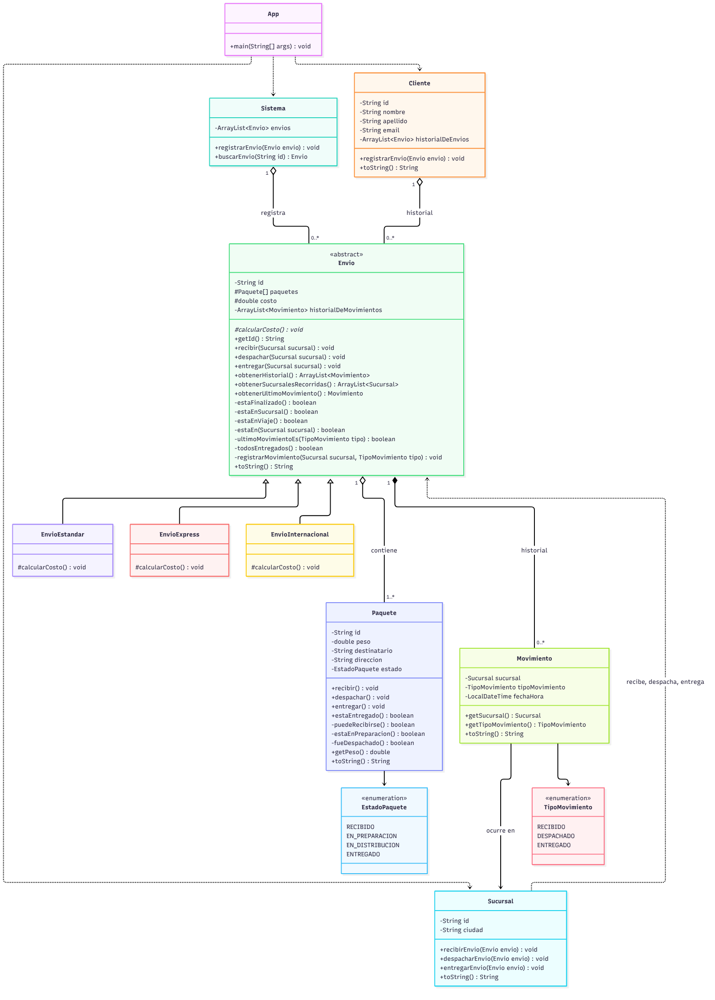
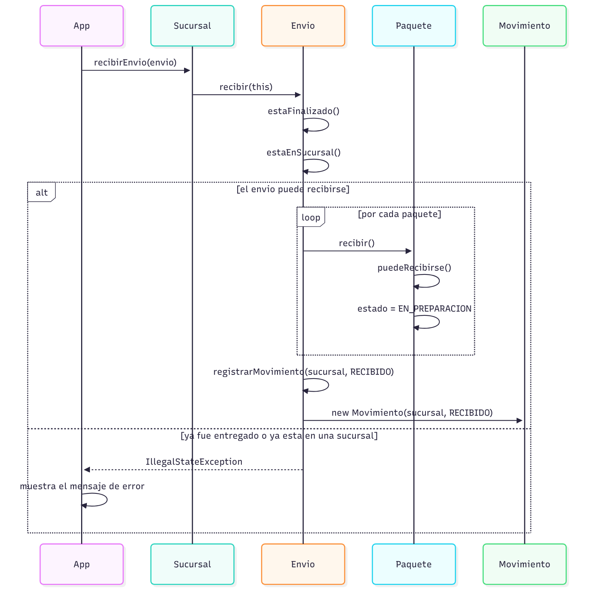
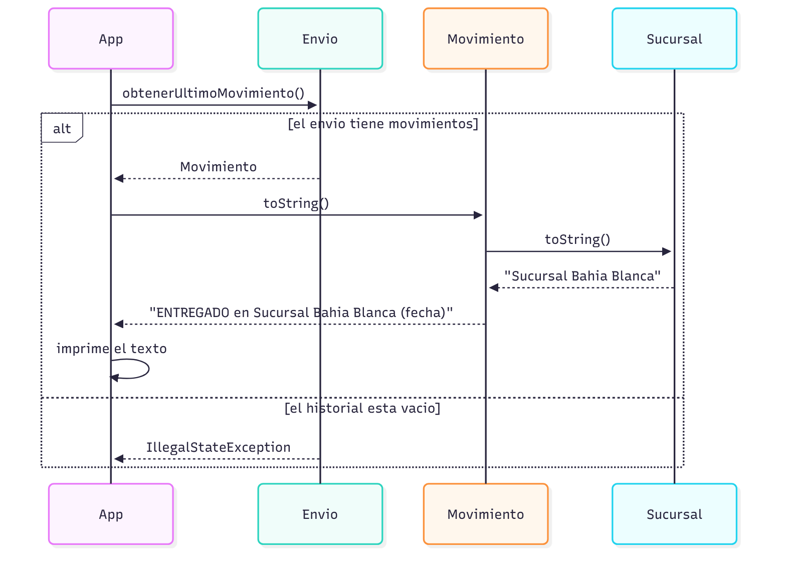

# Sistema de envíos - TP 2.1

Trabajo práctico de Programación Orientada a Objetos en Java.
Alumna: Daniela Albera

Sistema que registra envíos de paquetes y su recorrido por distintas sucursales, guardando el historial de movimientos de cada envío.

## Cómo ejecutarlo

Abrir la carpeta del proyecto en VS Code y ejecutar `src/app/App.java`.
El programa muestra un recorrido completo de un envío, las consultas del historial y los casos inválidos, cada uno con su mensaje de error.

## Diagramas

### Diagrama de clases

### Secuencia: recibir un envío

### Secuencia: consultar el último movimiento

## Mejoras realizadas

### Correcciones del TP2

- **Excepciones en lugar de booleanos.** Los métodos `recibir`, `despachar` y `entregar` de `Envio` ya no devuelven `true` o `false` para avisar si la operación salió bien. Ahora son `void` y lanzan una excepción cuando la operación no es válida. Los booleanos quedaron solo en métodos informativos, como `todosEntregados()`.
- **Se eliminó `avanzarEstado()` de `Paquete`.** Ese método concentraba todas las transiciones en una cadena de `if`. Lo reemplacé por tres acciones concretas: `recibir()`, `despachar()` y `entregar()`. Cada una valida su propia regla y lanza una excepción si la transición no corresponde.
- **Se agregó la acción `entregar`.** Antes la entrega ocurría sola dentro de `recibir`, según la cantidad de veces que se recibía el envío. Ahora es una operación explícita de `Sucursal`, `Envio` y `Paquete`.

### Requisitos del TP 2.1

- **Consultas del historial.** `Envio` tiene `obtenerHistorial()`, `obtenerSucursalesRecorridas()` y `obtenerUltimoMovimiento()`. Devuelven los objetos y es `App` la que los muestra. Ninguna clase del modelo imprime por pantalla.
- **Excepciones para los casos inválidos.** Entregar un envío no despachado, despachar un envío ya entregado, registrar un envío sin paquetes, registrar un movimiento incoherente, recibir un envío que está en otra etapa y operar sobre un envío inexistente.
- **Validaciones como métodos privados.** Las reglas de negocio tienen nombre propio y se reutilizan: `estaFinalizado()`, `estaEnSucursal()`, `estaEnViaje()` y `estaEn(sucursal)` en `Envio`; `puedeRecibirse()`, `estaEnPreparacion()` y `fueDespachado()` en `Paquete`.
- **Cambio de estado sin cadenas de `if` ni `switch`.** Cada objeto es dueño de su estado y decide si la operación es válida.
- **Colaboración por mensajes.** `App` le pide a `Sucursal`, `Sucursal` le pide a `Envio` y `Envio` le pide a `Paquete`. `App` nunca modifica el estado de un paquete, y `Envio` le pregunta al paquete `estaEntregado()` en lugar de pedirle el estado para compararlo.
- **Las excepciones se lanzan en el modelo y se atrapan en `App`.** La clase que conoce la regla es la que lanza la excepción, y `App` es la única que muestra el mensaje al usuario.

## Mejoras posibles a futuro

- **Excepciones propias del dominio.** Hoy uso las excepciones estándar de Java (`IllegalStateException`, `IllegalArgumentException`, `NoSuchElementException`). Se podrían crear excepciones propias, como `EnvioNoEncontradoException`, para que `App` distinga mejor cada tipo de error.
- **Reutilizar el cálculo del costo.** Los tres tipos de envío repiten el mismo recorrido de paquetes y solo cambia el recargo. Se podría dejar el cálculo base en `Envio` y que cada